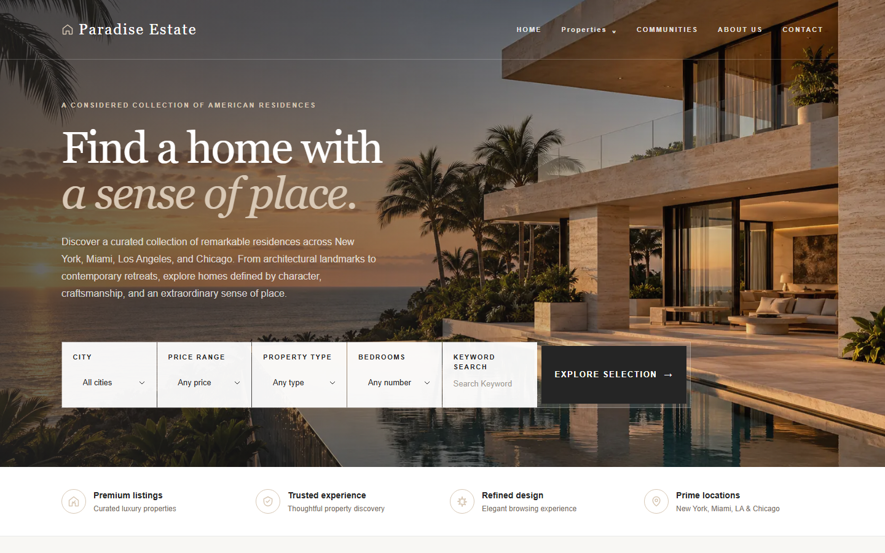
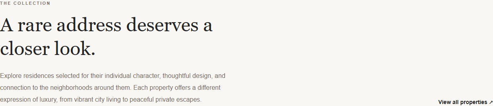
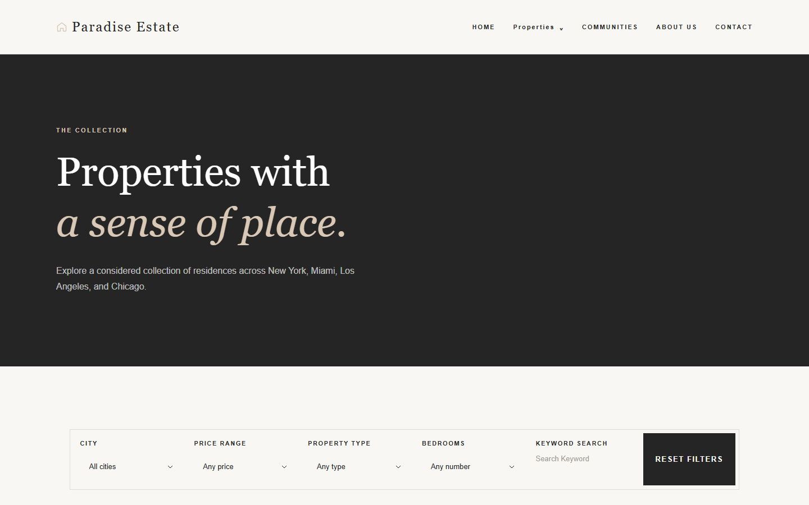
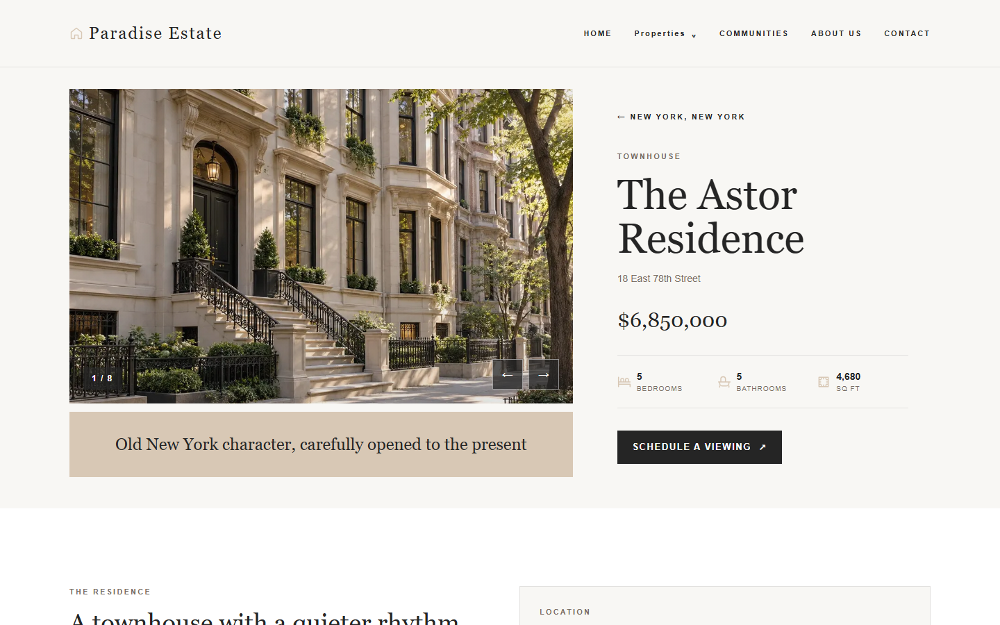
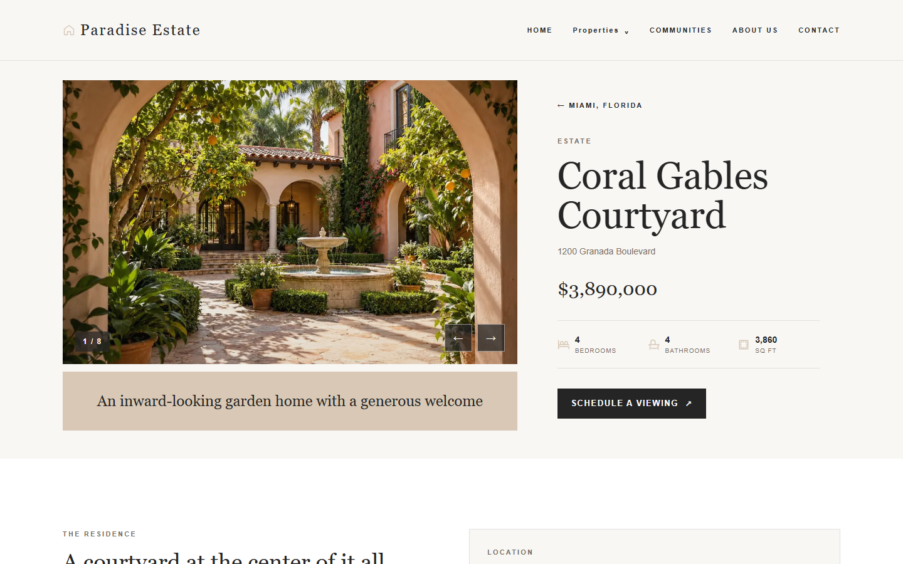
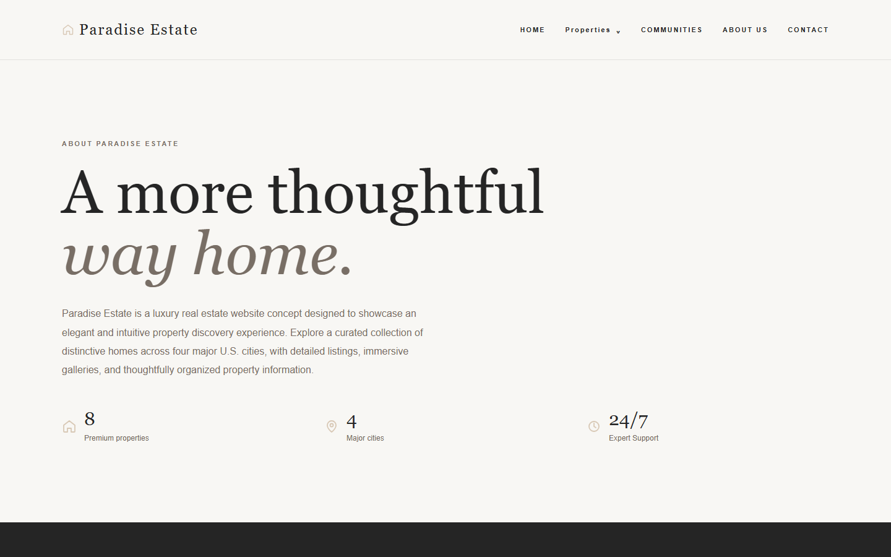
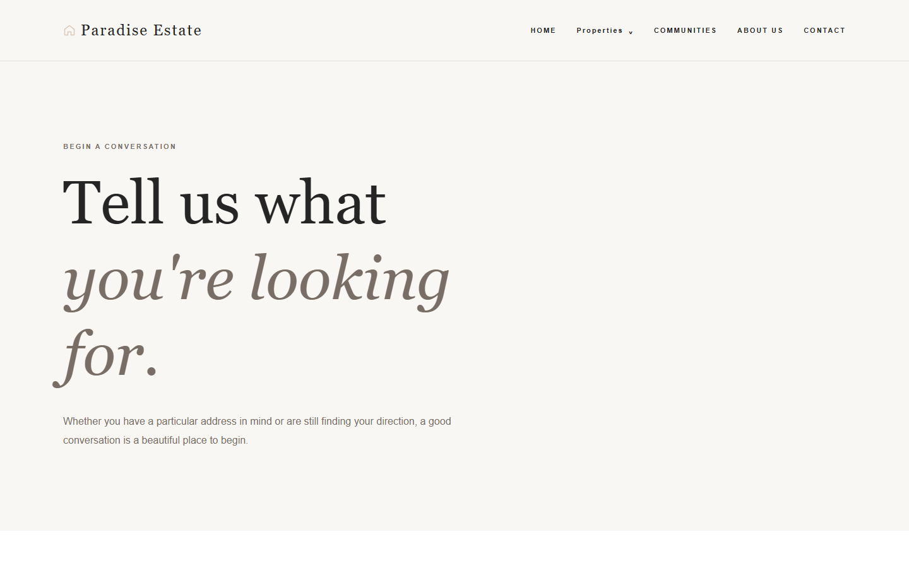
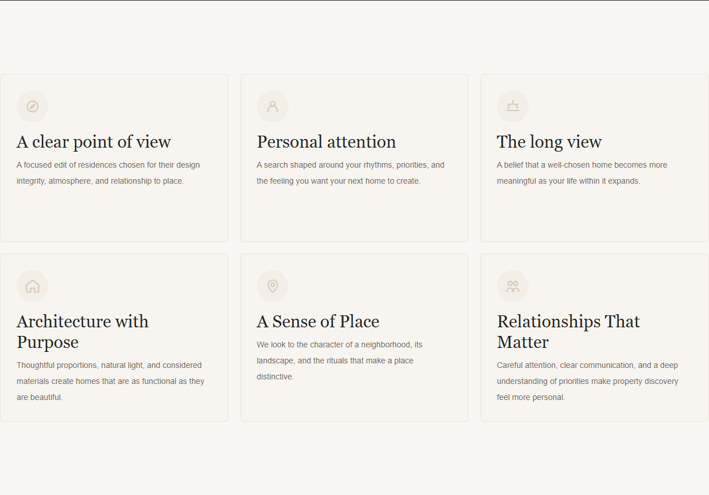
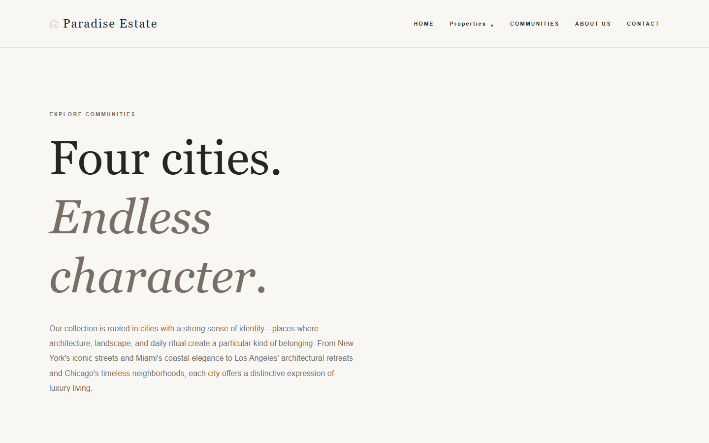

# Paradise Estate — Luxury Real Estate Portfolio Website

An engineering-focused, full-stack luxury real estate portfolio website built with Next.js, React, TypeScript, PostgreSQL, and Prisma. It demonstrates a polished public-facing experience for discovering curated residences across major American cities.

This is a software-engineering portfolio project, not a commercial real estate service or SaaS product. Property listings, addresses, photography, and editorial content are fictional demonstration material.

## Product concept

Paradise Estate explores how a premium real estate brand can pair editorial presentation with practical discovery tools. Visitors can browse a curated collection, narrow results by location and property characteristics, inspect detailed specifications, and begin an inquiry from a property-specific viewing journey.

## Key features

- Eight fictional luxury residences across New York, Miami, Los Angeles, and Chicago.
- City pages, keyword search, combined filters, URL-backed filter state, empty states, and 404 handling.
- Responsive property detail pages with eight-image touch, keyboard, and button-accessible carousels.
- Structured specifications, amenities, editorial detail, and descriptive image alt text.
- Inquiry and viewing-request API routes with validation, body-size limits, idempotency keys, and safe error responses.
- Responsive navigation with keyboard focus and Escape-key support.
- App Router metadata, robots rules, domain-aware sitemap generation, and baseline security response headers.

## Technology stack

- Next.js 16 App Router
- React 19 and TypeScript
- Tailwind CSS 4
- PostgreSQL with Prisma 7 and `@prisma/adapter-pg`
- Supabase-compatible PostgreSQL configuration
- Playwright and axe-core for browser and accessibility testing

## Scripts

- `npm run dev` — start the development server
- `npm run lint` — run ESLint
- `npm run build` — create a production build

## Production configuration

Keep credentials in the deployment environment only. `DATABASE_URL` is used by the application at runtime and `DIRECT_URL` is used by Prisma's migration tooling. `NEXT_PUBLIC_SITE_URL` must be set to the final HTTPS site origin before launch; the sitemap only emits public URLs and `robots.txt` only advertises the sitemap when that value is a non-local HTTPS origin.

Apply reviewed Prisma migrations through the deployment workflow with `npx prisma migrate deploy`, then run `npm run prisma:validate` and `npm run build`. Do not use `prisma migrate dev`, `prisma db push`, or reset commands against a deployed database.

The public write endpoints retain the Phase 6 F-602 limitation: distributed rate limiting and trusted client identity must be configured for the selected hosting platform before production launch.

## Repository layout

- `src/app` — App Router entrypoints and global styles
- `src/components` — reusable UI components
- `src/data` — future property and content data
- `src/lib` — shared utilities and integrations
- `src/types` — shared TypeScript types

## Demonstration assets

The architectural images in `public/images` are original AI-generated portfolio visuals. They do not represent real listings, locations, agents, or brokerage operations.

## Application architecture

```text
Next.js App Router
├── Server-rendered public pages and route metadata
├── Client components for filters, navigation, carousel, and inquiry UI
├── App Router API routes for properties, inquiries, and viewing requests
├── Prisma data-access layer with runtime property validation
└── PostgreSQL schema for properties, images, inquiries, and viewing requests
```

The frontend uses typed property data through server-side Prisma queries and API routes. Public write endpoints validate input, use idempotency keys to protect retries, and avoid returning raw database errors.

## Database and API capabilities

Prisma models cover properties, ordered gallery images, property inquiries, and viewing requests. The schema includes property/image relationships, ordered gallery uniqueness, idempotency-key uniqueness, and the reviewed migration history required by the project.

| Route | Capability |
| --- | --- |
| `GET /api/properties` | Listing, supported filters, and keyword search |
| `GET /api/properties/[city]` | City-scoped property listings |
| `GET /api/properties/[city]/[slug]` | City-safe individual property retrieval |
| `POST /api/inquiries` | Validated inquiry submission |
| `POST /api/viewing-requests` | Validated viewing-request submission |

The Contact form uses the inquiry endpoint. No external CRM, authentication, billing, or administrative dashboard is included.

## Responsive design and accessibility

The interface is designed for desktop, tablet, and mobile layouts, including touch navigation and responsive filters. Accessibility work includes semantic labels, visible focus indicators, keyboard gallery controls, accessible mobile navigation, descriptive image alt text, reduced-motion handling, and live announcement semantics for inquiry success.

## Verified quality checks

The following checks have passed in this project:

- ESLint
- TypeScript type checking
- Next.js production build
- Prisma schema validation
- Playwright browser suite: 37 passing tests
- Automated axe scans on desktop and mobile browser emulation with no serious or critical violations
- Image assignment verification: 8 properties, 64 unique gallery images, and 16 original images preserved

The browser suite covers public routes, all property detail pages, search/filter flows, navigation, gallery controls, contact-form UI states, responsive layouts, and horizontal-overflow checks. Form browser tests intercept write requests; they do not submit inquiries to a shared database.

## Local setup

### Prerequisites

- Node.js compatible with Next.js 16
- npm
- PostgreSQL-compatible database for server-side routes
- Playwright Chromium for browser tests

### Installation

```bash
npm install
npx playwright install chromium
```

Create a local `.env.local` file from `.env.example`, then provide valid server-side database values for local development. Never commit `.env.local`.

```bash
npm run dev
```

Open `http://localhost:3000`.

### Environment variables

| Variable | Purpose |
| --- | --- |
| `NEXT_PUBLIC_SITE_URL` | Local or final public site origin. A final non-local HTTPS origin enables public sitemap entries. |
| `DATABASE_URL` | Server-side runtime PostgreSQL connection used by Prisma. |
| `DIRECT_URL` | Server-side direct PostgreSQL connection used by Prisma CLI migration tooling. |

Only placeholder values belong in `.env.example`. Do not expose database URLs, passwords, tokens, or other credentials in source control.

## Commands

| Command | Purpose |
| --- | --- |
| `npm run dev` | Start the development server. |
| `npm run build` | Create a production build. |
| `npm run start` | Run the built application. |
| `npm run lint` | Run ESLint. |
| `npm run typecheck` | Run TypeScript without emitting files. |
| `npm run prisma:validate` | Validate the Prisma schema. |
| `npm run prisma:generate` | Generate Prisma Client. |
| `npm run test:e2e` | Run the Playwright functional, responsive, and accessibility suite. |
| `npm run test:performance` | Collect synthetic browser performance metrics against a local production server. |
| `npm run verify:images` | Verify property-gallery image assignments and uniqueness. |
| `npm run test:api-integration` | Run the isolated-database API integration runner; never point it at a shared or production database. |

For reviewed deployment migrations, use `npx prisma migrate deploy` only after verifying the intended environment and recovery plan. Do not use reset commands or `prisma migrate dev` against a deployed database.

## Screenshots

<p align="center">
  
</p>

| Home and discovery | Property experience |
| --- | --- |
|  |  |
|  |  |

| Editorial pages | Inquiry flow |
| --- | --- |
|  |  |
|  |  |

All screenshots are captured from the local application using its fictional demonstration data and imagery.

## Demo video

Placeholder: add a short walkthrough link or embedded video after recording it. No demo video is included in this repository yet.

## Technical highlights

- Typed boundaries across React components, API handlers, Prisma models, and property serialization.
- App Router route organization with static generation where appropriate and dynamic filtering where required.
- Defensive API design: validation, bounded JSON bodies, error sanitization, idempotency handling, and database constraints.
- Reusable responsive UI components with keyboard and touch interactions.
- Automated browser coverage across desktop and mobile emulation, plus accessibility scanning.

## Scope and limitations

- This is a portfolio demonstration, not a publicly deployed brokerage, marketplace, or SaaS platform.
- Listings and imagery are fictional and must not be treated as real inventory or availability information.
- A final public domain is intentionally not configured; sitemap publication and canonical URLs should be finalized only when a deployment domain is approved.
- Distributed production rate limiting and trusted client-IP handling remain hosting-dependent work and must be completed before any public production launch.
- The repository does not include a demo video, credentials, or backup archives.
