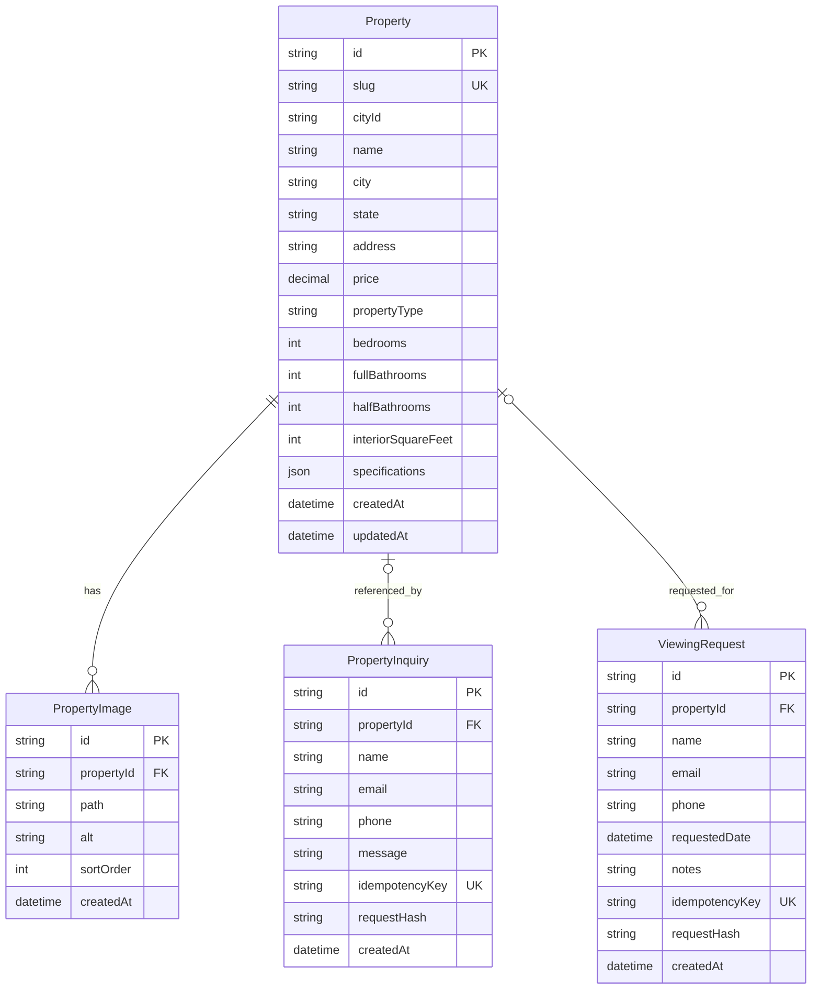

# Database Design

The PostgreSQL schema is defined in `prisma/schema.prisma` and is accessed through Prisma 7 with `@prisma/adapter-pg`. It stores the public property catalog, ordered property images, and public write submissions. Static source data in `src/data/properties.ts` is used for approved seed content and static route parameters; it is not a second live database.

## Entities and relationships

### `Property`

The primary catalog entity uses a CUID primary key and a globally unique slug. It contains address, pricing, editorial, core specification, and JSON specification fields. One property can have many ordered gallery images, inquiries, and viewing requests.

The migration history adds database `CHECK` constraints limiting `cityId` to `new-york`, `miami`, `los-angeles`, or `chicago`, and `propertyType` to `Estate`, `Penthouse`, `Townhouse`, or `Villa`.

### `PropertyImage`

Each image belongs to exactly one property and cascades on property deletion. `@@unique([propertyId, sortOrder])` guarantees one ordered image position per property. The `alt` field stores the descriptive text returned to the UI.

### `PropertyInquiry`

An inquiry may reference a property; the reference is optional to allow general contact submissions. If a property is removed, the foreign key becomes `NULL` rather than deleting inquiry history. `idempotencyKey` is optional but unique when supplied, and `requestHash` lets handlers distinguish a replay from a conflicting reuse of the same key.

### `ViewingRequest`

A viewing request always references a property. It has the same idempotency fields and `SetNull` relation behavior as inquiries, plus optional preferred date and notes fields.

## Integrity and query considerations

- Foreign keys connect images and submissions to property IDs.
- `Property.slug`, inquiry idempotency keys, and viewing-request idempotency keys are unique.
- Property images are indexed by `propertyId`; properties are indexed by `cityId`; inquiries and viewing requests are indexed by `propertyId`.
- The API validates structured `specifications` JSON and supported domain values again at serialization time. A malformed persisted record is rejected rather than exposed as a valid public listing.
- Prisma parameterizes database access; public search filters are parsed into typed query values before use.

No authentication, users, brokerage operations, payment records, or tenant entities are implemented. The property listings and any submission data belong to the portfolio demonstration only.
