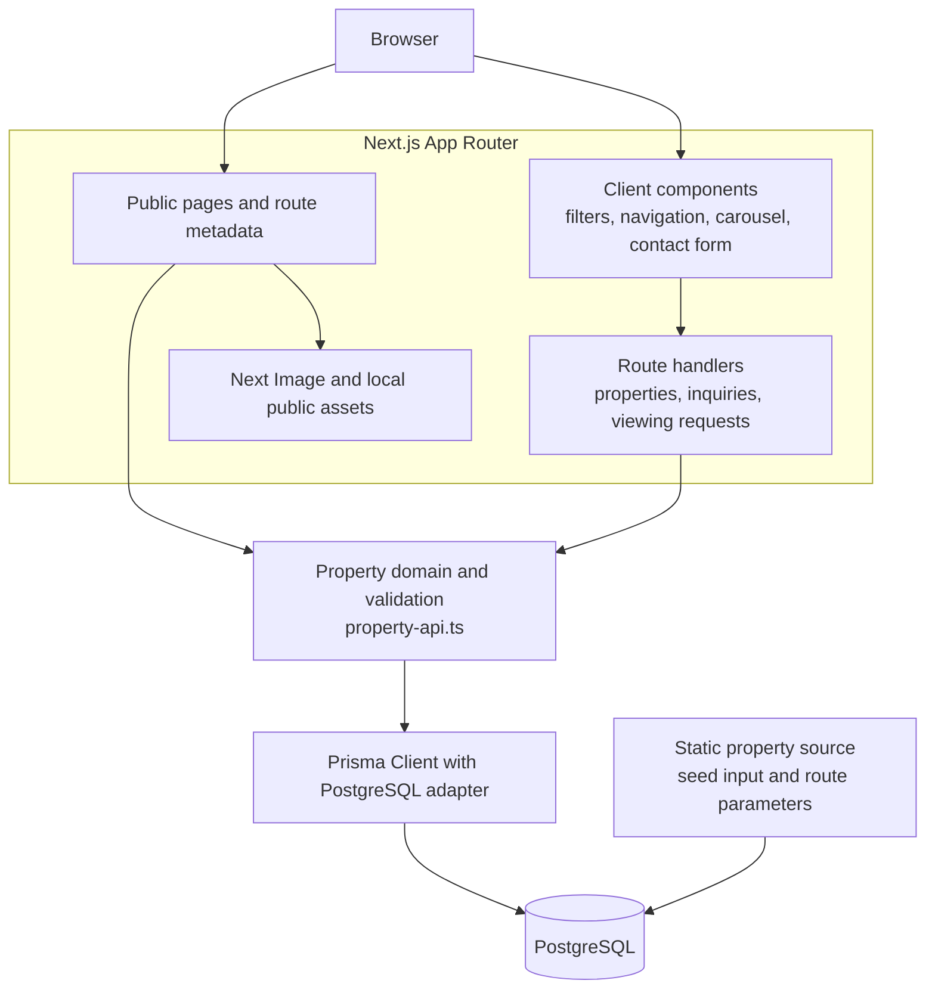

# System Architecture

Paradise Estate is a Next.js App Router application with a server-side PostgreSQL data layer. Public pages present fictional portfolio content; interactive filtering, navigation, carousel controls, and the contact form are implemented in React client components only where browser state is required.

## Major components

- **Browser and UI:** App Router pages render the public experience. Client components are used for browser-only interaction such as filter state, the mobile menu, carousel controls, and inquiry submission feedback.
- **Server-side application:** Page-level data access and App Router route handlers use the same property-domain utilities to validate search inputs, resolve city/slug combinations, and serialize records into the public API contract.
- **Database layer:** `src/lib/prisma.ts` creates a development-safe Prisma client backed by the PostgreSQL adapter. Prisma models persist properties, ordered gallery images, inquiries, and viewing requests.
- **Static assets and source data:** Local assets in `public/images` are served through Next.js image handling. `src/data/properties.ts` remains the approved seed source and supports static route parameters; persisted records are read through Prisma at runtime.

## Data and request flow

1. A visitor requests a public route. Server-rendered pages resolve property content through the domain layer and Prisma, while local images are delivered through Next.js image optimization.
2. Search and city filters produce validated URL state and use the property API for filtered results. The domain layer constrains supported cities, property types, price presets, bedroom ranges, and keyword length before composing Prisma queries.
3. Inquiry and viewing-request clients submit JSON to App Router handlers. Those handlers apply bounded body parsing, input validation, property-reference validation, idempotency handling, and sanitized error responses before Prisma writes.
4. `PropertyImage.sortOrder` determines gallery order. The property serializer validates persisted enum-like and structured JSON values before returning public data, so malformed records are not silently presented as valid listings.

## Design decisions

- **Shared domain utilities:** Search parsing, property lookup, serialization, and error handling are centralized in `src/lib/property-api.ts` instead of duplicated across page and API code.
- **Server-only persistence:** Database configuration is read server-side from `DATABASE_URL`; the Prisma configuration uses `DIRECT_URL` for migration tooling. Neither is exposed to browser code.
- **Route-safe property lookup:** City and slug are resolved together, preventing a property from being returned under the wrong city route.
- **Retry-safe writes:** The inquiry and viewing-request models retain optional idempotency keys and payload hashes. Their unique database indexes are used by the route handlers to return predictable replay or conflict responses.

## Operational boundary

The repository intentionally has no public deployment, authentication system, CRM, payment flow, or administrative UI. Distributed rate limiting and trusted platform-derived client identity remain a hosting-dependent pre-launch item; the repository’s current process-local limiter is not documented as a production-scale control.
